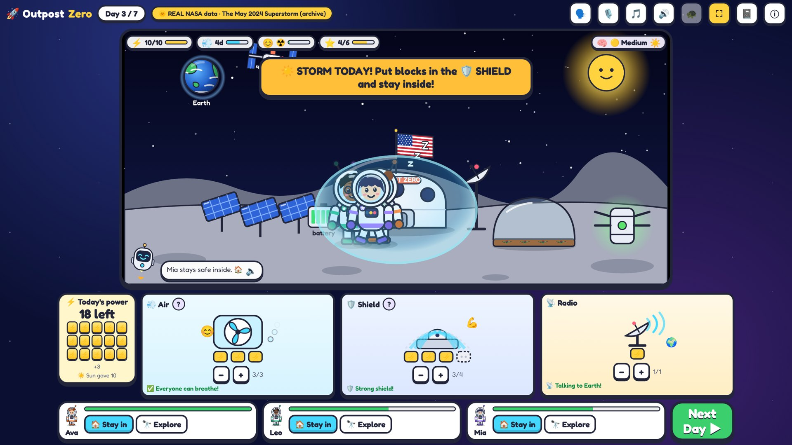

# 🚀 Outpost Zero — Junior Astronaut Mission Trainer

**NASA Space Apps Challenge 2026 · Challenge: Junior Astronaut Mission Trainer**

A free, fully animated cartoon browser game for kids **ages 7–12**. Players run a small outpost on **the Moon or Mars** for 7 days. Every day they split a limited supply of power between **air (life support)**, a **radiation shield**, the **radio to Earth** and (in Commander mode) a **greenhouse**, and give each of three astronauts a job. Then they watch what happens.

The solar storms in the game are **real**: they come from NASA's **DONKI** space-weather database, either the stored record of the May 2024 superstorm or the last 7 days of the real Sun, fetched live.

▶ **Play:** `https://phoenixcoder26.github.io/outpost-zero/`



**Team:** Phoenix_Coder26 (Farzana) · NASA Space Apps Challenge 2026 · Challenge: *Junior Astronaut Mission Trainer*

## What kids learn (the trade-offs)

| Choice | What it costs | The real constraint it teaches |
| --- | --- | --- |
| Power the **shield** on a storm day | Fewer blocks for air, radio or food | Radiation protection costs mass and power; storms come with little warning |
| Keep the **radio** on | One block every day | Science only counts when it reaches Earth; warnings depend on communication |
| Send an astronaut to **explore** | Extra radiation outside, and the shield can't help | Spacewalks are where the science is, and where the risk is |
| Save blocks in the **battery** | Less to spend today | The 14-day lunar night and Mars dust storms need stored or non-solar power |
| Pick the **reactor** from a supply rocket | Not picking another gift | Why NASA is building a 40 kW fission power plant for the Moon |
| **Mars** instead of the Moon | Earth's warnings arrive a day late | Radio takes 3–22 minutes to reach Mars, so Mars crews must decide alone |

No choice is free. There are 3 core meters for Cadets (ages 7–9): **Power, Air, Radiation**. Commanders (ages 10–12) also manage **Food**.

## Prizes and encouragement

- **Trophies:** a Gold Commander Trophy, Silver or Bronze Space Medal, or a Brave Explorer Ribbon, based on 3 stars: crew home safe, radiation in the green, science goal sent home.
- **9 animated badges**, e.g. Storm Shield Hero, Night Survivor, Dust Storm Champ, Space Farmer.
- A **printable Junior Astronaut Certificate** with the player's name.
- PIXEL the robot cheers good choices ("You are amazing!", "You are a star! ⭐"). If a mission ends early, the crew always flies home safely and PIXEL gives a kind tip. Failing is part of learning, never a punishment.

## NASA data used, and why

| Dataset | How we use it |
| --- | --- |
| [NASA DONKI](https://ccmc.gsfc.nasa.gov/tools/DONKI/) (via [api.nasa.gov](https://api.nasa.gov/)) | Schedules the solar storms. **Real Superstorm** mission: 14 real solar energetic particle (SEP) records from May 9–13, 2024 (retrieved 2026-11-13), plus the X-class flares reported for May 2024. **Live NASA Sky**: the last 7 days of real flares and SEP events. Each storm links to its DONKI record. |
| [OSDR RadLab](https://visualization.osdr.nasa.gov/radlab/gui/data-api/) | Notebook card comparing the outpost with real Space Station radiation readings |
| [NASA OSDR](https://osdr.nasa.gov/bio/repo/) | Why rest matters: space changes bones, muscles and sleep |
| NASA Curiosity RAD ([SwRI 2013](https://swri.org/node/9079)) | Mars surface radiation: 0.67 mSv/day |
| Chang'e 4 LND, CNSA ([Science Advances 2020](https://www.science.org/doi/10.1126/sciadv.aaz1334)) | Moon surface radiation: 1.37 mSv/day |
| [NASA radiation standard](https://www.nasa.gov/wp-content/uploads/2023/03/radiation-protection-technical-brief-ochmo.pdf) | 600 mSv career limit (our 150 mSv mission budget is a labeled game rule) |
| NASA Life Support Baseline Values (BVAD) | 0.82 kg oxygen and 1.8 kg food per astronaut per day |
| [NASA Fission Surface Power](https://www.nasa.gov/?p=602427) | 40 kW reactor; 14.5-day lunar night |
| [NASA MOXIE](https://www.jpl.nasa.gov/news/nasas-oxygen-generating-experiment-moxie-completes-mars-mission/) | Mars oxygen-maker upgrade |
| [CSA food production toolkit](https://www.asc-csa.gc.ca/eng/youth-educators/toolkits/food-production/) | Greenhouse and food ideas (space agency partner) |

**Honesty rules in the game:** every number is tagged REAL or GAME on the About page. The Practice Sky is labeled "made-up storms (not real data)". Stored data shows its date. If Live NASA Sky has no recorded particle events, any particle storm is labeled "estimated from a real flare".

## How it works

- Plain HTML, CSS and JavaScript (ES modules), with **no build step**. Hosted free on GitHub Pages.
- `js/sim.js` contains all the rules as **pure functions** with a seeded random generator, so the same seed and the same choices always give the same mission.
- `js/art.js` holds the original SVG cartoon art, animated with [GSAP](https://gsap.com) (bundled in `vendor/`). `js/fx.js` has the canvas particles plus music and sound effects **synthesized in the browser** (no licensed audio).
- `js/sky.js` turns DONKI events into the storm schedule.
- `scripts/fetch-nasa.mjs` and `.github/workflows/fetch-nasa.yml` save a fresh DONKI snapshot to `data/live/donki.json` every morning, so the browser never needs an API key. If the snapshot is missing, the game calls the API with the shared DEMO_KEY, then falls back to the archive.
- Accessibility: read-aloud (the browser's built-in speech), Calm Mode, the system "reduce motion" setting is honored, no flashing faster than 3 times per second, big touch targets, drag **or** +/− buttons, keyboard play.
- Privacy: no accounts, no tracking, no ads. Progress is saved only in the browser (localStorage).

## Run it locally

```bash
python3 -m http.server 8000      # then open http://localhost:8000
npm test                         # 9 rule tests (Node 18+)
node tests/balance.mjs           # win rates for robot players
```

(ES modules don't load from `file://`, so use a local server.)

## Deploy (GitHub Pages)

1. Push this folder to a **public** GitHub repo named `outpost-zero`.
2. **Settings → Pages → Deploy from a branch → `main` / root → Save.**
3. Optional live data: get a free key at [api.nasa.gov](https://api.nasa.gov/), add it under **Settings → Secrets and variables → Actions** as `NASA_API_KEY`, then **Actions → Fetch NASA space weather → Run workflow**.

## Credits and AI disclosure

Original game design, art, music and code by the Outpost Zero team for NASA Space Apps 2026. We used **Claude (Anthropic)**, an AI assistant, to help research NASA sources, plan the design and write and test the code. The team reviewed and tested all AI-assisted work. **The game prototype was started on Nov 13, 2026, the day before the hackathon, and finished during the event.** The cartoon art, music and sound are drawn and synthesized in code (SVG and Web Audio), and that code was written with Claude's help, so we label them AI-assisted. The demo video is a screen recording of the real game and carries an "AI assistance" watermark. NASA logos and insignia are not used in the game.

GSAP is used under the GreenSock standard "no charge" license; the Fredoka font under the SIL Open Font License.

License: MIT (see `LICENSE`).
